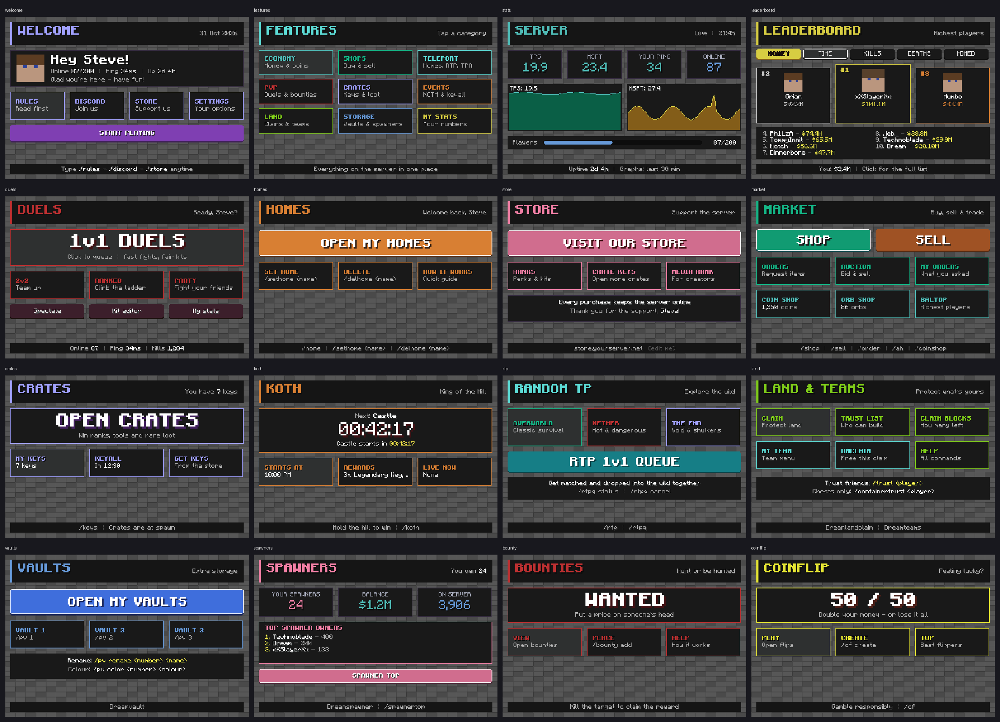

# DreamScreens

Clickable **map touchscreens** you build and edit **in game**, with 16 ready-made designs. Holograms and NPCs come included.

- **Platforms:** Spigot, Paper, Purpur and Folia
- **Versions:** 1.20.4 up to 26.x. NPCs need Paper 1.21.9+
- **Requirements:** nothing else needed. PlaceholderAPI is optional



## Quick start (2 minutes)

**1. Make a screen with a ready design.** Look at the wall block that should be the top-left corner, then run:
```
/screen create lobby 3 2 welcome
```

**2. Change it in game:**
```
/se lobby
```
Click anything on the screen to select it, then change it:
```
/se text &lHello!
/se color gold
/se move center 20
```

**3. Finish:**
```
/se done
```

## The in-game editor (`/se`)

Start with `/se` while looking at a screen, or `/se <screen>`. Stop with `/se done`.

While you edit:
- Clicking a thing on the screen selects it (yellow outline + number). Clicking the same spot again selects the thing underneath.
- Your action bar shows the exact x/y you're pointing at.
- Clicks select things instead of running buttons. Other players keep seeing the normal screen.

**Select and arrange:**

| Command | What it does |
|---|---|
| `/se select [n]` | Select by number (`/se list` shows all) |
| `/se list` | Lists every element on the page |
| `/se info` | Shows what's selected |
| `/se move <x> <y>` | Moves it. Accepts `20`, `-20` (from the far edge), `50%` and `center` |
| `/se here` | Moves it to where you're looking |
| `/se up\|down\|left\|right [px]` | Nudges it by a few pixels |
| `/se size <w> <h>` | Sets the size |
| `/se grow <+w> <+h>` | Grows or shrinks it |
| `/se front` | Brings it to the front layer |
| `/se back` | Sends it to the back layer |
| `/se copy` | Duplicates it |
| `/se remove` | Removes it |

**Add things:**

| Command | What it does |
|---|---|
| `/se add text <text>` | Adds text where you're looking |
| `/se add button <text>` | Adds a button |
| `/se add rect` | Adds a box or card |
| `/se add image <file.png>` | Adds an image from `images/` |
| `/se add head [player]` | Adds a player's face |
| `/se add progress` | Adds a progress bar |
| `/se add graph [online\|tps\|mspt]` | Adds a live graph |
| `/se add lines <a\|b\|c>` | Adds several lines of text |

**Look:**

| Command | What it does |
|---|---|
| `/se text <text>` | Sets the text. For `lines`, use `\|` between lines |
| `/se color <c>` | Sets the colour |
| `/se hover <c>` | Sets the colour when someone looks at it |
| `/se textcolor <c>` | Sets a button's text colour |
| `/se border <px> [c]` | Adds a border, or `off` |
| `/se scale <1-8>` | Sets the text size |
| `/se align left\|center\|right` | Aligns the text |
| `/se shadow on\|off\|<colour>` | Sets the text shadow |
| `/se set <property> <value>` | Sets any property directly |
| `/se unset <property>` | Puts a property back to its default |

Colours can be `#FF5555`, a name (`black` `white` `gray` `red` `orange` `gold` `yellow` `lime` `green` `aqua` `blue` `purple` `pink` `brown`...) or `none`.

**Buttons:**

| Command | What it does |
|---|---|
| `/se action add <action>` | Adds an action, e.g. `page:shop` or `link:https://...` |
| `/se action remove <n>` | Removes one action |
| `/se action clear` | Removes all actions |
| `/se action list` | Lists the actions |

**Pages and background:**

| Command | What it does |
|---|---|
| `/se page` | Lists pages |
| `/se page <name>` | Opens a page (`/se page open <name>` also works) |
| `/se page add <name> [copy-of]` | New page, optionally a copy of another |
| `/se page remove <name>` | Removes a page |
| `/se page rename <old> <new>` | Renames a page; button links follow |
| `/se page start <name>` | The page players see first |
| `/se page next <page> [sec]` | Slideshow: moves on by itself |
| `/se page refresh <ticks>` | How often live numbers redraw |
| `/se bg black\|none\|#hex` | Background colour. `none` = see-through, the wall shows |
| `/se bgimage <file.png\|off>` | Background picture |

**Helpers:**

| Command | What it does |
|---|---|
| `/se grid` | Positioning grid, every 16 px; cyan = middle |
| `/se undo` | Undoes the last change. It remembers 30 changes per screen |
| `/se save <design>` | Saves the screen as a design to reuse anywhere |
| `/se scroll on [speed]` | Makes text scroll like a news ticker |
| `/se font <file.ttf> [size]` | Uses a custom font on text |
| `/se transition <type> [ticks]` | Animates page changes |
| `/se sync on\|off` | Slideshow follows the clock |
| `/se sound <sound>` | Sound on every page change |
| `/se auto add <page> <condition>` | Auto page |
| `/se schedule add <page> <from> <to>` | Scheduled page |

Everything the editor does is written to `plugins/DreamScreens/screens/<screen>.yml`. You can still edit that file by hand and run `/screen reload <screen>`.

## Live screens: slideshows, announcements, auto pages

**Slideshow:** a page moves on to the next by itself.
```
/se page next event 10
```
Chain pages into a loop. With `/se sync on`, the slideshow follows the clock, so everyone sees the same page at the same time.

**Transitions:** `/se transition wipe|slide|down|split|none [ticks]` animates every page change.

**Sounds:**
- `/se sound <sound>` plays on every page change.
- `/se page sound <sound>` plays when one particular page opens.

**Announcements:** take over every screen for a few seconds, then everything goes back to normal.

| Command | What it does |
|---|---|
| `/screen announce koth 30` | Shows the `koth` announcement for 30 seconds. Ready pages: koth, event, restart, giveaway, maintenance |
| `/screen announce text 20 Big title\|second line` | Shows your own text for 20 seconds |
| `/screen announce event 30 lobby arena` | Shows it on just these screens |
| `/screen announce stop` | Ends the announcement now |

Edit the announcement pages in `announcements.yml`. Other plugins can run these commands from the console, e.g. when a KOTH starts.

**Auto pages:** show a page while a condition holds. The first rule that holds wins.
```
/se auto add live %koth_is_running% == true
/se auto add soon {countdown:2026-12-31 20:00} == LIVE
/se auto add busy {online} >= 50
```
Conditions support `==` `!=` `>` `<` `>=` `<=` and `contains`. They are checked every second.

**Schedule:** show a page between two times of the server clock. It also works past midnight.
```
/se schedule add night 22:00 06:00
```

**Linked screens:** `/screen mirror <screen> <source>` makes a screen show another screen's pages. Editing either one changes both. Add `/se sync on` and they flip pages together.

**Priority**, highest first: editing → announcement → auto page → schedule → slideshow / normal page.

## Moving and fancy content

**Scrolling text (news ticker):** `/se add text ...`, then `/se scroll on 40`. The width comes from `/se size <w> 10`.

**GIFs:** put an animated `.gif` in `images/` and use it like any image (`/se add image intro.gif`). Frames are read the way browsers show them.

**Custom fonts:** put a `.ttf` in `plugins/DreamScreens/fonts`, then run `/se font MyFont.ttf 24` on a text element. `&colours`, hex and `&l` bold still work. Use `/screen fonts` to list your fonts.

**Clickable links:** `/se action add link:https://discord.gg/abc Join our Discord` sends a clickable link in chat.

## Ready-made designs
DreamScreens ships with 16 designs for 3x2 screens. They use a see-through background with dark cards:

| Design | For |
|---|---|
| `welcome` | New players: head, online/ping/uptime, rules, discord, store, settings |
| `features` | Browse everything: 9 categories, each with its own page of buttons |
| `stats` | TPS, MSPT, ping, players, TPS/MSPT graphs, uptime |
| `leaderboard` | Live Dreamleaderboard top 10: podium with heads, 5 tabs |
| `duels` | Big "1v1 DUELS" card, 2v2, ranked, party, your stats |
| `homes` | DreamHomes |
| `store` | Store and media rank |
| `market` | Shop, sell, orders, auction, coin and orb shop |
| `crates` | Keys and keyall timer |
| `koth` | KOTH countdown, status, rewards |
| `rtp` | Overworld, nether, end and the 1v1 RTP queue |
| `land` | Claims and teams |
| `vaults` | Player vaults |
| `spawners` | Spawner stats and top owners |
| `bounty` | Bounties |
| `coinflip` | Coinflip |

Use them with these commands:
- `/screen designs` lists the designs.
- `/screen design <screen> <design>` puts a design on a screen. The old page is kept as `.bak`.
- `/screen create <name> <w> <h> <design>` makes a new screen with a design.

The designs live in `plugins/DreamScreens/designs/`. Edit them or add your own (`/se save`). Your edits are never overwritten.

## Screens: commands
| Command | What it does |
|---|---|
| `/screen create <name> <w> <h> [design]` | Look at the wall block for the top-left corner. The screen grows right and down. 1x1 up to 10x10 |
| `/screen create <name> <w> <h> [design] at <world> <x> <y> <z> <facing>` | Same from the console. The coordinates are the block in front of the wall |
| `/screen delete <name>` | Removes a screen |
| `/screen list` | Lists all screens |
| `/screen info <name>` | Shows a screen's details |
| `/screen tp <name>` | Teleports you in front of a screen |
| `/screen reload [name]` | Reloads pages and images |
| `/screen page <screen> <page\|back\|home> [player]` | Opens a page for someone |
| `/screen set <name> viewrange\|touchrange\|cursor <value>` | Changes a screen setting |
| `/screen icon <name> <item\|off> [scale] [spin]` | Puts a spinning item above the screen, e.g. `red_bed` |
| `/screen images` | Lists your images (`plugins/DreamScreens/images/`, PNG or JPG) |
| `/screen announce <name\|text\|stop> ...` | Takes over screens for a few seconds |
| `/screen mirror <screen> <source\|off>` | Linked screens |
| `/screen fonts` | Lists your custom fonts |
| `/screen respawn <name>` | Places a screen's frames again |

**How touching works:**
- Players click from up to 8 blocks away (punch, left-click the air, or right-click).
- They see a mouse cursor, buttons light up when looked at, and buttons press down when clicked.
- Every player sees their own page, hover and placeholders.

## Live values
| Kind | Placeholders |
|---|---|
| Player and server | `{player}` `{online}` `{max}` `{ping}` `{world}` `{time}` `{date}` `{tps}` `{mspt}` `{uptime}` |
| Dreamleaderboard top 10 | `{lb_<type>_<rank>_name}` and `{lb_<type>_<rank>_value}`. Types: money, playtime, mobs, deaths, placed, broken |
| Your own stats | `{stat_playtime}` `{stat_kills}` `{stat_deaths}` `{stat_mobs}` `{stat_placed}` `{stat_broken}` |
| Countdown | `{countdown:2026-12-31 20:00}` |
| Colours that change with a value | `<status:{tps};19+=#22C55E;15-18.99=#FACC15;default=#EF4444>` |

PlaceholderAPI `%placeholders%` also work, including their MiniMessage colours. On Folia, TPS and MSPT are for the region you stand in.

## Holograms (`/holo help`) and NPCs (`/npc help`)
**Holograms:**
- Text, item and block holograms
- Spin, bob, and a pop-up when a player comes near
- Per-player placeholders, click actions, and all the FancyHolograms options

**NPCs:**
- Built on the vanilla Mannequin entity (Paper 1.21.9+)
- Skins, look-at, glow, pose, equipment and click actions
- A spinning icon above the head and a pop-up info panel

On older servers or on Spigot, `/npc` explains that NPCs need Paper 1.21.9+. Screens and holograms still work.

## License (Dreamscube)
DreamScreens checks its license with the Dreamscube license server (https://dreamscube.fun), the same system the other Dream plugins use.

- **Key:** `license-key` in `config.yml`. If DreamScreens was downloaded from BuiltByBit, the buyer's key is put into the jar automatically and copied to the config on first start.
- **Checks:** on start, then every heartbeat (30 min by default). Answers are signed (Ed25519), so a fake license server can't unlock it.
- **Server unreachable:** the last good answer keeps the plugin running until its grace time ends (48 h by default). A Cloudflare hiccup never takes a customer's server down.
- **Wrong key, revoked, IP limit, and so on:** the plugin switches itself off and the console says why and what to do.
- **Updates:** ops get an in-game note when a newer version is set in the admin panel.

**Admin panel setup (once):**
1. Products → add **DreamScreens**.
2. Set ID `dreamscreens` and key prefix `DS`.
3. Set the BuiltByBit resource ID once the resource is uploaded.

## Notes
- **Coming from DreamNFM:** your `plugins/DreamNFM` folder is copied over on first start. Permissions are now `dreamscreens.*`. `/dreamnfm` and `/nfm` still work as aliases.
- **Performance:** screens only exist for nearby players. Pages with nothing live on them never redraw on their own. The cursor updates every tick only for players standing in front of a screen.
- **Bedrock (Geyser):** players see screens, but may see the item-frame border. Holograms and NPCs may not show.
- **Building from source:** `mvn package` creates `dist/target/DreamScreens.jar`. Core is Java 17; the NPC part is Java 21 and only loads on servers that have Mannequins.
